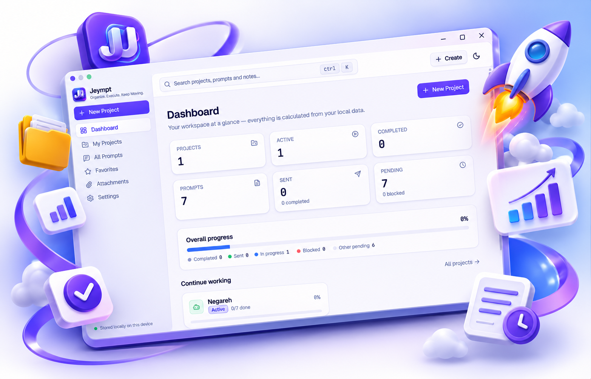

# Jeympt

### Organize. Execute. Keep Moving.

**Jeympt** is a modern workspace for organizing projects, managing AI prompts, and tracking multi-step workflows. Keep your prompts, notes, dependencies, and project attachments organized in one place — and always know what to do next.

---

## 📸 Screenshot

---

## ✨ Features

- **Centralized Dashboard** — Get an overview of your projects, prompts, progress, and recent activity.
- **Project Management** — Create, organize, track, duplicate, and manage multiple projects.
- **Multi-Step Prompt Management** — Organize prompts into structured sequences and track their execution status.
- **Step Ordering & Dependencies** — Reorder workflow steps and define dependencies between prompts.
- **Notes & Descriptions** — Add notes, instructions, and important reminders between prompts.
- **File Attachments** — Attach and manage images, JSON files, documents, and other project resources.
- **Quick Copy & Status Tracking** — Copy prompts instantly and keep track of sent, pending, and completed steps.
- **Local Data Storage** — Keep your workspace and project information stored locally.

---

# فارسی

### جی‌مپت | Jeympt
**سازمان‌دهی کن، اجرا کن و ادامه بده.**

اپلیکیشن **Jeympt** یک فضای کاری مدرن برای مدیریت پروژه‌ها، سازمان‌دهی پرامپت‌های هوش مصنوعی و پیگیری فرایندهای چندمرحله‌ای است.

با جی‌مپت می‌توانی تمام پرامپت‌ها، یادداشت‌ها، وابستگی مراحل و فایل‌های مرتبط با پروژه‌هایت را در یک محیط یکپارچه مدیریت کنی و همیشه بدانی قدم بعدی چیست.

## ✨ امکانات

- **داشبورد مرکزی** — مشاهده وضعیت پروژه‌ها، تعداد پرامپت‌ها، میزان پیشرفت و فعالیت‌های اخیر.
- **مدیریت پروژه‌ها** — ایجاد، سازمان‌دهی، پیگیری و مدیریت چندین پروژه به‌صورت مستقل.
- **مدیریت پرامپت‌های چندمرحله‌ای** — دسته‌بندی پرامپت‌ها در مراحل منظم و پیگیری وضعیت اجرای هر مرحله.
- **مدیریت ترتیب و وابستگی مراحل** — جابه‌جایی مراحل و تعیین پیش‌نیازهای اجرای هر پرامپت.
- **یادداشت‌گذاری و توضیحات** — افزودن یادداشت‌ها، دستورالعمل‌ها و یادآوری‌های مهم بین پرامپت‌ها.
- **مدیریت فایل‌ها و پیوست‌ها** — افزودن و مدیریت تصاویر، فایل‌های JSON، اسناد و سایر فایل‌های مرتبط با پروژه.
- **کپی سریع و پیگیری وضعیت** — کپی آسان پرامپت‌ها و مدیریت وضعیت ارسال‌شده، در انتظار و تکمیل‌شده.
- **ذخیره‌سازی محلی اطلاعات** — نگهداری اطلاعات پروژه‌ها و فضای کاری به‌صورت محلی.

---

**Jeympt — Your prompts. Your projects. Your workflow.**